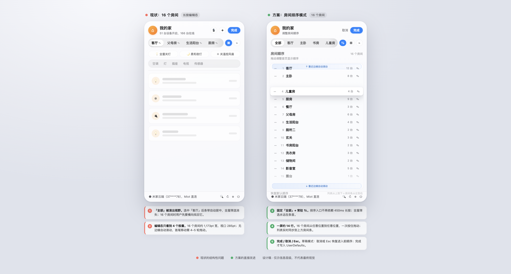
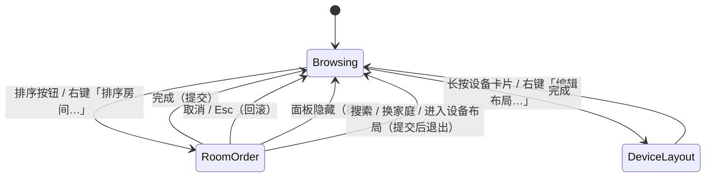

# 首页房间排序交互优化设计

状态：已实现（`feat/room-order-interaction`）　日期：2026-11-05　关联：#146、#222　平台：macOS　版本：v3（已按两轮独立评审的 must-fix 修订）

## 0. 结论

把房间排序从「长按 450ms 进入抖动编辑、在 285pt 宽的横向条里拖 4 个可见胶囊」改为「房间条固定一个『排序』按钮，点开后首页内容区切换成完整的『房间顺序』列表」。

列表一次展示全部房间，拖动、键盘、VoiceOver 都能完成排序；房间条在上方实时预览排序结果，但不再承担排序手势。16 个房间可以在一次连续拖动内从任意位置到任意位置，不再需要「拖一段、滚一下、再拖一段」。

这个方案同时修掉三个与排序直接相关的老问题：唯一入口是隐藏手势、`全部` 会被滚出视野、编辑态按回车会误控设备。



> 草图为信息层级与空间关系示意，不代表最终视觉；实现按现有 `DesignTokens` 与 `AppleMotion` 落地。

## 1. 目标与不变量

### 1.1 目标

1. **可发现**：排序入口是房间条上的常驻按钮，有 tooltip 和无障碍名称，不依赖长按教学。
2. **可达**：16 个房间时，任意两行之间一次拖动或一次键盘操作可达；不再受横向视口限制。
3. **可逆**：排序有明确的「完成 / 取消」语义，`Esc` 取消并恢复进入前的顺序；重置只作用于当前可见范围。
4. **可访问**：鼠标、键盘、VoiceOver 三条路径都能完成同一组排序操作。
5. **一致**：点按胶囊仍然只是切换房间；设备排序、房间归属、云端数据都不受影响。

### 1.2 不变量

- `RoomArea.id` 仍是唯一排序键；`room_custom_order` / `room_aliases` 仍是本地偏好，不回写 Home Assistant 或米家云端。
- 「全部」不是房间，不参与排序，固定显示在房间条最左侧。
- `DeviceLayoutPrefs`（设备顺序、尺寸）与 `RoomPrefs`（房间顺序、别名）互不影响。
- 暂时从快照里消失的房间继续保留别名与槽位，与 #146 的既有规则一致。
- 排序结果立即反映到房间条与 `Tab` / `Shift-Tab` 的房间循环顺序。

## 2. 现状审计摘要

审计基线 `62c9246`，只读检查 `Sources/MenuBarMijiaApp/`、`Tests/` 与快照；下列问题均带代码行号，可独立复核。

### 2.1 当前交互链路

1. 唯一入口是在真实房间胶囊上按住 **450ms**，位移不超过 8pt 才成立（`Sources/MenuBarMijiaApp/ControlCenterPanelLayout.swift:80-94`）；全仓只有这一处把 `isEditingRooms` 置为 `true`，没有按钮、右键菜单、菜单栏命令或键盘入口。
2. 进入后所有胶囊开始抖动，胶囊内出现 14×14pt 铅笔，条尾追加「重置」胶囊；拖动使用 `DragGesture(minimumDistance: 0)` 与 `ScrollView` 并存（`ControlCenterPanelChrome.swift:617-624`）。
3. 拖动只在指针落入另一个胶囊 frame 时交换位置，0.2s 节流；松手不结算最终落点（`ControlCenterPanelLayout.swift:126-139`、`:100-110`）。
4. 条带没有边缘自动滚动，`scrollRoomStrip` 只在面板打开、选中房间变化等非拖动时调用（`ControlCenterPanelChrome.swift:632-644`）。

### 2.2 关键问题与影响

| 严重度 | 问题 | 证据 | 用户影响 |
|---|---|---|---|
| 高 | 16 个房间时编辑态只有约 4 个完整胶囊可见，且无边缘自动滚动 | 348pt 行宽减去 57pt 视图按钮与 6pt 间距后，滚动视口 285pt；编辑态二字胶囊约 63.8pt（含铅笔），4 个即 270pt（`ControlCenterPanelChrome.swift:611-702`、`:756-780`） | 首尾移动需要约 4-5 轮「拖动 → 松手 → 滚动 → 再拖」，基本不可用 |
| 高 | 唯一入口是隐藏的 450ms 长按 | `ControlCenterPanelLayout.swift:80-94`；`isEditingRooms = true` 全仓仅此一处 | 新用户无法发现；键盘与 VoiceOver 用户无法进入 |
| 高 | 编辑态按 Return 被全局按键监视器截获为「切换聚焦设备」 | `HotkeyAndNotificationManager.swift:408-410`，`Done` 的 `.defaultAction` 在 `ControlCenterPanelLayout.swift:688` | 用户想按回车完成排序，可能误开/关设备 |
| 中 | 房间顺序没有 `liveOrder` 内存镜像，`@AppStorage` 写入可能造成拖动瞬移 | `ControlCenterPanel.swift:14-16` 的设备注释与 `:31-34` 的房间状态对比；写入路径在 `ControlCenterPanelLayout.swift:136-138` | 排序过程可能跳变，用户误以为没生效 |
| 中 | 「全部」在可滚动内容里，选中房间居中后会被滚出视野 | `ControlCenterPanelChrome.swift:446-468`、`:613-644`；本机 16 房间开屏实测 | 最常用的全局筛选入口消失 |
| 中 | 重置无确认、无撤销，且一次清空全部家庭/账号的别名与顺序 | `ControlCenterPanelLayout.swift:155-162`、`ControlCenterPanelChrome.swift:452-464` | 误触后无法恢复，跨家庭偏好被连坐 |
| 中 | VoiceOver 只能通过 context menu 单步左移/右移；选中态没有 `.isSelected`，编辑态提示要求「拖动」但没有可执行 action | `ControlCenterPanelChrome.swift:801-830` | 辅助功能用户只能一次次走菜单，16 房间成本极高 |
| 中 | 编辑提示被 `.lineLimit(1)` 截断，英文文案必截断 | `ControlCenterPanelChrome.swift:114-118`、`:364-371` | 用户看不到完整操作说明 |
| 低 | 16 个胶囊各自运行 `TimelineView(.animation)` 抖动，另有每胶囊 `GeometryReader` | `ControlCenterPanel.swift:697-711`、`ControlCenterPanelChrome.swift:477-490` | 编辑态持续 CPU/耗电开销 |

结论：问题不是「拖拽手感差一点」，而是横向条在 16 房间规模下**结构上无法承载排序任务**。继续在原条带里加自动滚动，只能把 4-5 轮缩短到 2-3 轮，仍然依赖用户在建模式后「盲拖」；因此需要把排序任务迁移到一个能同时看见全部房间的视图。

## 3. 设计依据

- **拖拽应当一次动作开始，不要先选中再等待**：HIG《Drag and drop》明确不建议在选中与开始拖拽之间加入停顿；当前 450ms 长按正好违反这一点。[HIG · Drag and drop](https://developer.apple.com/design/human-interface-guidelines/drag-and-drop)
- **拖动必须提供替代路径**：HIG 要求为拖放提供菜单命令等替代方式，并尽量允许撤销。[同上]
- **macOS 的长按不是标准拖拽手势**：HIG《Gestures》把 click-drag 作为桌面拖拽方式，把 touch-and-hold 用于「显示额外控件」，且自定义手势必须有可发现、可执行的替代路径。[HIG · Gestures](https://developer.apple.com/design/human-interface-guidelines/gestures)
- **可访问性底线**：核心功能必须能用多种物理交互完成，并支持仅用键盘；不能把指针手势作为唯一路径。[HIG · Accessibility](https://developer.apple.com/design/human-interface-guidelines/accessibility)
- **列表重排有先例**：列表应支持重排；iOS/iPadOS 先进入编辑态再选择项目，macOS 的工具栏自定义也提供明确的编辑入口。[HIG · Lists and tables](https://developer.apple.com/design/human-interface-guidelines/lists-and-tables)、[HIG · Toolbars](https://developer.apple.com/design/human-interface-guidelines/toolbars)
- **竞品模式**：Apple Home 与 Control Center 都用「更多 / 编辑控制」显式进入重排模式，完成后点「完成」；Finder 工具栏自定义通过菜单命令进入；Safari 标签页是直接拖动，但标签栏本身提供左右滚动与溢出处理。[Apple Home 使用手册](https://support.apple.com/guide/home/hmea9c3e49ed/mac)、[Control Center 使用手册](https://support.apple.com/guide/mac-help/mchlc9d0e1f2/mac)、[Finder 工具栏](https://support.apple.com/guide/mac-help/mchlp3011/mac)

## 4. 方案对比

| 维度 | 方案 A：排序模式 + 完整列表（推荐） | 方案 B：增强现有就地拖拽 | 方案 C：只放进设置页 |
|---|---|---|---|
| 16 房间全部可见 | 是，一屏约 10-14 行，余下滚动 | 否，仍只有 4 个胶囊 | 是 |
| 入口发现性 | 高，常驻排序按钮 | 中，需要补按钮；否则仍靠长按 | 低，要离开首页 |
| 任意两位置一次移动 | 是 | 需要边缘自动滚动，仍可能多次 | 是 |
| 键盘 / VoiceOver | 天然适合列表行操作 | 手势仲裁复杂，成本高 | 可以，但路径远 |
| 误触风险 | 低，明确的模式与 Done/Cancel | 中，拖动与点选、滚动共用区域 | 低 |
| 实现风险 | 中，新增一个视图与状态机；删除旧手势代码 | 中高，SwiftUI 手势优先级与自动滚动难保证 | 低 |
| 结论 | **采用** | 作为未来可选的快捷手势，不进入本期验收 | 不采用；其「列表」形态被方案 A 复用 |

方案 A 把「管理列表」直接放在首页内容区，而不是设置页或独立窗口：菜单栏面板是一个短生命周期的浮层，跳到设置页会丢失首页上下文，而独立窗口会关闭面板。内容区替换既保留上下文，也避免额外窗口层级。

## 5. 推荐方案详规

### 5.1 信息架构与入口

**普通态房间条**（从左到右）：

```
[全部]  [客厅] [主卧] [书房] [……横向滚动……]     [⇅] [▦] [⌁]
                                                  ↑   ↑   ↑
                                              排序按钮 视图切换
```

- `全部` 从滚动内容中移出，固定在轨道左端；只有房间胶囊参与横向滚动。这样无论选中哪个房间，用户都能一键回到全屋视图。
- 新增 **排序按钮**：26×24pt，SF Symbol `arrow.up.arrow.down`，与现有两个视图切换按钮同规格；常驻可见，tooltip「房间排序」，无障碍标签「房间排序」，提示「调整房间在首页的显示顺序」。
- 排序按钮只在房间数 ≥ 2 时显示；0/1 个房间没有排序意义。
- **不再保留 450ms 长按入口**：长按在 macOS 上不是标准拖拽方式，而且它是当前唯一的隐藏入口；排序统一从可见按钮或右键菜单进入。这样也能删掉 `roomPressTask` / `roomPressCancelled` 与整段手势仲裁逻辑。
- 房间胶囊右键菜单保留「左移 / 右移」，并新增「排序房间…」入口；单步微调不必打开排序模式。

**排序模式**（内容区替换设备网格，顶部房间条保留为实时预览）：

```
┌──────────────────────────────────────────┐
│ 🏠 我的家                         取消 完成 │
│    拖动房间调整首页显示顺序                │
├──────────────────────────────────────────┤
│ [全部] 客厅 主卧 书房 儿童房 …      [⇅] [▦] [⌁] │
├──────────────────────────────────────────┤
│ 房间顺序                          16 个房间 │
│ 拖动调整首页显示顺序                        │
│ ┌──────────────────────────────────────┐ │
│ │ ⠿ 1   客厅                 12 台  ✎ │ │
│ │ ⠿ 2   主卧                  8 台  ✎ │ │
│ │ ⠿ 3   书房                  5 台  ✎ │ │
│ │ ⠿ 4   儿童房                4 台  ✎ │ │
│ │ …                                    │ │
│ └──────────────────────────────────────┘ │
│ 恢复默认顺序                                │
└──────────────────────────────────────────┘
```

- 排序模式不弹 sheet、不换窗口：`mainDashboard` 里原来放设备网格的区域换成房间列表，顶栏、房间条和底栏保留；快捷场景条、类型筛选行、onboarding banner 与设备网格一并隐藏，避免干扰并把高度让给列表。
- 排序模式下房间条只作为**实时预览**：胶囊不可点选、不可拖动、不显示铅笔与重置胶囊；列表里的顺序变化即时反映在条上。**紧凑面板（460pt）隐藏房间条预览**，把高度让给列表；标准/加高保留。
- 列表高度不足时使用垂直 `ScrollView`，行高 30pt；标准面板约 10 行、加高面板约 14 行可见，剩余行通过滚动访问。**排序模式整体替换 `mainDashboard` 的外层纵向 `ScrollView` 分支，不嵌套滚动**；进入时清空 `tileFrames` 并不挂 `tileDragGesture`（`ControlCenterPanel.swift:280-332`）。

### 5.2 状态机

当前 `isEditingLayout` 与 `isEditingRooms` 两个布尔值由各入口手工互相清零（`ControlCenterPanelLayout.swift:87`、`:487`、`ControlCenterPanel.swift:135`），容易出现两个同时为 true 的非法状态。建议改成单一枚举，并把排序会话状态放进已有的共享 `@Observable` `LayoutUIState.shared`（`DeviceLayout.swift:562-579`；`PanelSearchState.shared` 是同类先例），因为 `HotkeyAndNotificationManager` 的 key monitor 也要读它：

```swift
enum PanelEditMode: Equatable {
    case none
    case deviceLayout
    case roomOrder
}

// 在现有 LayoutUIState 上新增：
var editMode: PanelEditMode = .none
var roomOrderDraft: RoomOrderDraft?
var focusedRoomId: String?
func beginRoomOrder(rooms: [RoomArea], order: [String], aliases: [String: String])
func commitRoomOrderIfNeeded()
func cancelRoomOrder()
func dismissActivePrompt() -> Bool    // Esc 关闭当前重命名/新建提示
#if DEBUG
func resetForTesting()
#endif
```



状态转换规则：

- 进入 `roomOrder` 时，`LayoutUIState.shared.beginRoomOrder` 拍下完整 `initialOrder`（包含其他家庭/账号的 ghost id）与 `initialAliases`；后续拖动和改名只写会话草稿，不写 `UserDefaults`。
- **完成**（Done、Return、面板隐藏、搜索/换家庭/进入设备布局等服务性退出）统一走 `exitRoomOrder(.commit)`：把草稿合并写回 `room_custom_order` / `room_aliases`，再回 `browsing`。
- **取消**（Cancel 按钮或 `Esc`）走 `exitRoomOrder(.cancel)`：丢弃草稿，房间条恢复进入前顺序。只有显式取消才回滚。
- `MenuBarPanelController.hidePanel()` 会在点面板外、⌘Tab、打开设置、Esc 阶梯等所有路径触发；必须先在 `hidePanel` 内调用 `LayoutUIState.shared.commitRoomOrderIfNeeded()`，而不是依赖视图的 `onDisappear`（拖动中 `DragGesture.onEnded` 不保证执行）。
- **写回通道**：`LayoutUIState` 不是 `@AppStorage` 的持有者，`commitRoomOrderIfNeeded()` 通过新增的 `RoomPrefs.persist(order:aliases:to: UserDefaults = .standard)` 直接写 `RoomPrefs.orderKey` / `aliasesKey`；`ControlCenterPanel` 的 `@AppStorage` 会观察同一 `UserDefaults.standard` 的变化。这样 `hidePanel` 与 `applicationWillTerminate` 都不需要拿到 SwiftUI 视图状态。新增 `MenuBarMijiaAppDelegate.applicationWillTerminate`（`MenuBarMijiaApp.swift:58-63`）调用同一方法。
- 进入搜索、切换到设备布局、切换家庭等路径都调用同一个 `exitRoomOrder(.commit)`，不能带着草稿跨越上下文。

### 5.3 列表行规格

| 元素 | 规格 | 行为 |
|---|---|---|
| 行高 | 30pt，圆角 9pt，水平内边距 8pt | 悬停时背景 `Color.primary.opacity(0.05)` |
| 抓手 | 左侧 20×20pt，`line.3.horizontal`，始终可见（不依赖 hover） | 按住行任意位置（铅笔除外）拖动；抓手提供视觉提示，也可作为精确热区 |
| 序号 | 18pt 宽，`DesignTokens.TypeSize.caption`，等宽数字，secondary | 让用户与读屏都知道「第几项 / 共几项」 |
| 房间名 | 13pt medium，单行截断；别名与原名不同时，右键菜单展示原名 | 点击不切换房间；名称过长用 tooltip 显示全名 |
| 设备数 | 11pt secondary，格式「12 台」 | 帮助区分同名/相似房间 |
| 重命名 | 右侧 24×24pt 铅笔按钮，命中区不小于 24×24pt | 打开现有 `GroupNamePrompt`，编辑的是会话草稿中的别名 |
| 拖动态 | 被拖行缩放 1.02、加 0.18 黑色阴影、zIndex 提升；其余行让出插入空隙 | 松手后 spring 归位 |
| 插入指示 | 目标位置显示 2pt 高强调色圆角线 | 让用户知道会落在哪 |
| 空态 | 0/1 个房间不显示排序按钮（§5.8） | 避免无意义入口 |

行本身不设置 `Button`；拖动用列表容器上的 `DragGesture(minimumDistance: 3)`，铅笔按钮用 `.highPriorityGesture` 或独立命中层，避免点铅笔时被行拖动抢走。

### 5.4 拖动与边缘自动滚动

- **开始**：在行上按下并移动超过 3pt 即拿起，不需要长按、不需要先进入另一层编辑；符合 HIG「一次动作开始拖拽」。
- **跟手**：被拖行随指针纵向移动，限制在列表可见范围内；相邻行按目标 index 平移，形成空隙。
- **自动滚动**：指针进入列表可视区上下边缘各 24pt 时启动；速度从 120pt/s 线性升到 600pt/s，指针越靠边越快；离开边缘立即停止。16 行时通常一屏可见 10-14 行，即使从第 16 行拖到第 1 行，也只需一次按住不放。
- **实现提示**：SwiftUI 的 `ScrollView` 不直接暴露滚动偏移，自动滚动应通过一个小的 `NSViewRepresentable` 拿到底层 `NSScrollView`，或用 `ScrollViewReader` + 逐帧 `scrollTo`。仓库已有 `HorizontalWheelScrollMonitor`（`Sources/MenuBarMijiaApp/ThemeAndMotion.swift:644-809`）通过 `NSScrollView` 处理横向滚动的先例，可复用同一桥接方式。
- **落点**：以被拖行中心越过目标行中线作为换位判定，按 `RoomPrefs.move(_:id:relativeTo:after:)` 的同一语义更新草稿；每次换位触发一次 `.alignment` 触感。
- **松手**：补一次最终落点结算，再以 `AppleMotion.snappySpring` 归位；这是对现状「0.2s 节流窗口内松手不结算」的修正（`ControlCenterPanelLayout.swift:100-110`）。
- **实现选择**：优先评估系统 `List` + `.onMove`（原生行移动与滚动），若 16 行原型证明自研 `ScrollView` + `NSViewRepresentable` 自动滚动可达 60fps 再采用自研；不建议在 `View` 的 `@State` 里每帧更新整块面板，拖动位置用行内 `@GestureState` 隔离重绘。
- **Reduce Motion**：显式用 `withAnimation(reduceMotion ? nil : ...)` 控制缩放/阴影/spring，只保留 120ms 透明度过渡；不要依赖根视图 `.transaction { disablesAnimations = true }`（`ControlCenterPanel.swift:203`）——它会把必要的状态过渡也一起关掉。自动滚动仍生效。

### 5.5 键盘与 VoiceOver

排序模式下的按键优先级高于面板现有快捷键（这是修复 `Return` 误控设备的关键）：

| 按键 | 行为 |
|---|---|
| `↑` / `↓` | 在列表行之间移动焦点 |
| `⌘↑` / `⌘↓` | 把当前焦点行上移/下移一位 |
| `⌘Home` / `⌘End` | 移到最前 / 最后 |
| `Return` | 完成（提交并退出） |
| `Esc` | 取消（回滚并退出） |
| `Tab` / `Shift-Tab` | 在列表行之间移动焦点，而不是切换房间筛选 |

- 按键路由顺序必须明确：① `PanelSearchKeyboard.handle` 先执行；② **若 `LayoutUIState.shared.renamingRoomId`/`renamingDeviceId`/`renamingGroupId`/`newGroupForDevice` 任一非空，先处理 prompt**：`Esc` 调共享的 `dismissActivePrompt()`（或显式调用该 prompt 的 `onCancel`）后返回 true，`Return`/↑↓ 交给文本框；不能落入现有 `HotkeyAndNotificationManager.swift:364-375` 的「Esc → makeFirstResponder(nil)」分支。③ `LayoutUIState.shared.editMode == .roomOrder` 时拦截下表按键；④ `editMode == .deviceLayout` 时 Return 返回 false，交给 `doneEditingButton` 的 `.defaultAction`，避免被 `:408-410` 的 `toggleFocusedDevice` 截获；⑤ 其余才落到现有的 `store.toggleFocusedDevice()` / `store.moveFocus()` / `cycleRoom`（`HotkeyAndNotificationManager.swift:348-431`）。
- `LayoutUIState` 是共享 `@Observable`，排序会话状态不能是 `ControlCenterPanel` 的私有 `@State`：key monitor 只持有 `HomeStore`（`HotkeyAndNotificationManager.swift:12-14`），读不到 SwiftUI 视图状态。
- `doneEditingButton` 的 `.defaultAction`（`ControlCenterPanelLayout.swift:688`）在排序模式下会被 key monitor 先按 Return 处理；设备布局模式仍沿用该默认动作。Tab 在排序模式下改为移动列表焦点，普通模式仍按 `RoomPrefs.storedOrder()` 切房间（`HotkeyAndNotificationManager.swift:414-418`）；排序模式预览期间不得让 Tab 按旧顺序切房间。
- 每行提供 VoiceOver 自定义动作：「上移」「下移」「移到最前」「移到最后」；标签包含位置，例如「客厅，12 台设备，第 2 个，共 16 个」；移动后通过 `AccessibilityNotification.Announcement` 播报新位置。
- 普通态的房间胶囊也补上 `.accessibilityAction(named:)` 的「左移 / 右移 / 移到最前 / 移到最后」，并补 `.accessibilityAddTraits(.isSelected)`；这样 VoiceOver 用户即使不进入排序模式也能做单步调整。
- 铅笔按钮的 14×14pt 点击区扩大到 24×24pt（`ControlCenterPanelChrome.swift:766-770` 的现状）。

### 5.6 重命名

- 排序模式中的铅笔打开现有 `GroupNamePrompt`（`ControlCenterPanelLayout.swift:389-416`），标题「重命名房间」。现有 prompt 的 `onSave`/`onReset` 直接写 `roomAliasesRaw`（`:397-412`），排序模式需要传入一个写 `RoomOrderDraft.aliases` 的变体；普通态的右键重命名仍走原来的立即写入路径。
- 输入写入 `LayoutUIState.shared.roomOrderDraft.aliases`，列表与房间条实时显示；「完成」时一次提交，「取消」整体回滚。
- 保存原名时继续沿用 `RoomPrefs.alias(for:in:)` 的空别名规则；不改变设备别名与搜索匹配逻辑。
- 别名最大长度建议 20 个字符（按字素计数），超出截断到胶囊显示宽度；当前无上限（`DeviceLayout.swift:582-634`），16 个房间时长别名会把一个胶囊撑满整个视口。该上限可作为后续小任务，不阻塞排序主路径。

### 5.7 重置的语义

现有「重置」同时清空 `room_aliases` 与 `room_custom_order`，无确认，且是全局 key（`ControlCenterPanelLayout.swift:155-162`）。建议拆开：

- 排序模式底部「恢复默认顺序」：只把当前草稿顺序恢复为 `store.rooms` 的 provider 顺序，**不触碰别名**；因为仍在草稿阶段，点「取消」可整体回滚。实现算法：先从草稿 order 中移除当前可见房间 id（其他家庭/账号的 ghost id 留在原相对顺序），再把可见房间按 provider 顺序追加到末尾；不能用 `rooms.map(\.id)` 直接覆盖整个全局数组。
- 草稿初始化必须使用完整的 `RoomPrefs.seededOrder(storedOrder, rooms: store.rooms)`（保留所有历史 id），`reconcile` 只标记可见性，不删除 ghost id；这保证换家庭、快照抖动、房间暂时消失都不会丢掉其他家庭的槽位。
- 每行重命名弹窗保留「恢复原名」单项操作。
- 不提供「一键清空所有房间名称与顺序」的入口；若后续确有需求，必须二次确认并限定当前家庭/账号。
- 这样跨家庭、跨账号的别名与顺序不会被一次误触连坐（审计问题 #6）。

### 5.8 「全部」与空态

- `全部` 固定在条首，不参与排序列表；排序模式中的副标题写「拖动调整首页显示顺序」，「全部」保持固定位置。
- 0 个房间：隐藏排序按钮，保留现有空状态（`emptyStateView`）。
- 1 个房间：隐藏排序按钮（与 §5.1 一致），不进入排序模式。
- 房间在排序模式下新增：`RoomOrderDraft.reconcile(rooms:)` 把它追加到列表末尾并显示「新」标记一次，不中断当前拖动。
- 房间在排序模式下消失：**只从可见列表隐藏，不从草稿 order 删除**；如果正被拖动，取消拖动并保持列表稳定。这样房间恢复时仍回到原槽位（与 §1.2 一致）。

### 5.9 视觉与文案

- 使用现有 `DesignTokens` 与 `AppleMotion.snappySpring`；不新增颜色族。
- 排序模式顶部状态文案改为短句「调整房间顺序」，避免当前 167pt 中文提示在 166pt 可用宽度里临界截断的问题（审计 §5.3）；英文用「Reorder rooms」。列表内副标题用「拖动调整首页显示顺序」/「Drag to set the home order」。
- 房间条上方与列表内各放一次长说明属于重复，顶栏状态行只保留短句；完整说明放在列表标题下。
- 排序按钮激活时使用现有 `PillActionButtonStyle(isSelected: true)` 的强调色底。
- 所有新增文案都走 `L10n.tr`，中英成对：房间排序 / Room order、房间顺序 / Room order、拖动调整首页显示顺序 / Drag to set the home order、恢复默认顺序 / Restore default order、取消 / Cancel、完成 / Done、N 个房间 / N rooms、N 台 / N devices。

## 6. 数据与代码落点

### 6.1 纯模型

新建 `Sources/MenuBarMijiaApp/RoomOrderDraft.swift`（不要塞进已经 635 行的 `DeviceLayout.swift`；`RoomPrefs` 本身在 App 层，纯模型测试通过 `@testable import MenuBarMijiaApp` 运行）：

```swift
struct RoomOrderDraft: Equatable {
    private(set) var order: [String]      // 完整历史 order，含其他家庭/账号的 ghost id
    private(set) var aliases: [String: String]
    let initialOrder: [String]
    let initialAliases: [String: String]

    init(order: [String], aliases: [String: String])
    mutating func move(id: String, relativeTo target: String, after: Bool)
    mutating func moveToFront(id: String)
    mutating func moveToEnd(id: String)
    mutating func rename(id: String, to alias: String?)
    mutating func reconcile(rooms: [RoomArea])   // 只更新可见性，不删 ghost id
    mutating func resetOrder(rooms: [RoomArea])  // 保留 ghost id，只重排当前可见房间
    func visibleOrder(for rooms: [RoomArea]) -> [String]
    func isDirty(currentRooms: [RoomArea]) -> Bool // order 或 alias 任一变化
}
```

- 复用 `RoomPrefs.move(_:id:relativeTo:after:)` / `shift` / `seededOrder` / `apply` 的既有规则，不重写排序算法。
- `isDirty` 用于「完成」按钮是否可点与「取消」是否需要确认。
- 纯模型测试放在新 `Tests/MenuBarMijiaAppTests/RoomOrderDraftTests.swift`，覆盖：单步/多步移动、before/after 边界、到首/到尾、重复 id、未知 id、**ghost id 保留**、**reset 不删除其他家庭 id**、房间消失/恢复、新增房间、别名 dirty、取消恢复初始值。

### 6.2 视图与状态

| 文件 | 改动 |
|---|---|
| `Sources/MenuBarMijiaApp/ControlCenterPanel.swift` | 把 `isEditingLayout` / `isEditingRooms` 收敛为 `PanelEditMode`；保留 `isEditingLayout` 计算属性并继续注入现有 EnvironmentKey（`DeviceLayout.swift:172-181`、`ControlCenterPanel.swift:204`），这样 `DeviceCardView` / `SensorCardView` / `ClimatePanelModule` 等 35 处读取不用改；删除 `RoomPillJiggle`（`:697-712`）与旧拖动状态 `draggingRoomId` / `roomDragLocation` / `roomGrabOffset` / `roomFrames` / `lastRoomSwapAt` / `lastRoomSwapTarget` / `roomPressTask` / `roomPressCancelled`（`:36-43`），以及搜索切换里的 `roomDragLocation = nil`（`:191`）；`displayRooms` 在排序模式下读 `layoutUI.roomOrderDraft` |
| `Sources/MenuBarMijiaApp/ControlCenterPanelLayout.swift` | 删除 `roomStripGesture`、`beginRoomDrag`、`roomDragOffset`、`swapRoomIfNeeded`、`resetRoomPrefs` 以及 `roomDragLocation` 残留引用（`:108`、`:682`）；`moveRoom` 保留给右键「左移 / 右移」；`doneEditingButton` 按 `PanelEditMode` 分派提交/退出，新增 Cancel 调用 `LayoutUIState.shared.cancelRoomOrder()` |
| `Sources/MenuBarMijiaApp/ControlCenterPanelChrome.swift` | 房间条固定 `全部`；新增排序按钮与排序模式下的「取消」按钮；删除胶囊内铅笔、「重置」胶囊与全局重置菜单项；右键菜单保留重命名/左移/右移并新增「排序房间…」；删除 `.onPreferenceChange(RoomFramesKey.self)`（`:621-624`）、`roomPillRowItem` 里的 `roomDragOffset` 偏移、`RoomFramesKey` 测量与 `draggingRoomId` 的 `.zIndex`（`:473-491`）以及 `RoomPillJiggle` 调用（`:831`） |
| `Sources/MenuBarMijiaApp/RoomOrderEditor.swift`（新文件） | 排序模式列表：行视图、拖动会话、自动滚动、键盘焦点、VoiceOver action、底部恢复默认 |
| `Sources/MenuBarMijiaApp/HotkeyAndNotificationManager.swift` | 读取 `LayoutUIState.shared.editMode` 做排序模式优先的键盘路由（↑↓、⌘↑↓、Return、Esc、Tab）；路由顺序按 §5.5：prompt 优先、roomOrder 次之、deviceLayout 的 Return 放行；修复 Return 落回 `toggleFocusedDevice` 的问题 |
| `Sources/MenuBarMijiaApp/MenuBarMijiaApp.swift` | `MenuBarMijiaAppDelegate` 新增 `applicationWillTerminate`，调用 `LayoutUIState.shared.commitRoomOrderIfNeeded()`（`:58-63`） |
| `Sources/MenuBarMijiaApp/DeviceLayout.swift` | 删除 `RoomFramesKey`（`:346-353`）；`RoomPrefs` 增加 `moveToFront` / `moveToEnd` / `defaultOrder` / `persist(order:aliases:to:)` 辅助函数（persist 走 `seededOrder` 合并、保留 ghost id）；`LayoutUIState` 增加 `dismissActivePrompt()` 与 `#if DEBUG resetForTesting()`；`reset` 函数可保留但不再有全局 UI 入口 |

### 6.3 持久化与动画

- 排序模式在「完成」或任一会触发提交的隐式退出（面板隐藏、搜索、换家庭、进入设备布局、应用退出）时写 `roomOrderRaw` / `roomAliasesRaw`；只有显式「取消」/`Esc` 不写。`@AppStorage` 的发布不再是拖动路径的一部分，因此不会出现拖动中的 snap。
- `MenuBarPanelController.hidePanel()` 必须调用 `LayoutUIState.shared.commitRoomOrderIfNeeded()`（见 §5.2），不能只依赖 `ControlCenterPanel` 的 `onDisappear`。
- 房间条渲染在排序模式读 `layoutUI.roomOrderDraft`，普通态读 `RoomPrefs.apply(order: decodeOrder(roomOrderRaw), ...)`；提交时两者顺序一致，视觉无跳变。
- 提交后的房间条如需平滑过渡，增加 `@State var liveRoomOrder: [String]?` 内存镜像，沿用设备顺序的 `liveOrder` 模式（`ControlCenterPanel.swift:14-16`、`ControlCenterPanelLayout.swift:641-648`），不要只依赖 `@AppStorage` 的动画。

## 7. 分阶段实施与验证

### 7.1 实施切分（建议 2 个 PR）

**PR 1：排序模式主路径（可独立发布、可独立验证）**

1. 先做 16 行列表原型：确认系统 `List` + `.onMove` 是否满足行拖动/自动滚动；不满足再走 `ScrollView` + `NSViewRepresentable` 方案。原型只用于技术选型，不合并废弃实现。
2. 给 `SnapshotFixture` 增加 `roomCount: 16`、`editMode: .roomOrder` 注入能力，并在 `init`/`restore()` 中调用 `LayoutUIState.shared.resetForTesting()`（清 `editMode`/`roomOrderDraft`/`focusedRoomId`），并**保存再恢复** `RoomPrefs.orderKey`/`aliasesKey` 的原值（`SnapshotTests.swift:414-427` 目前只恢复语言/外观/温度）——不能直接清空，否则 `swift test` 会抹掉开发者真实的房间偏好；参考 `Tests/MenuBarMijiaAppTests/SnapshotTests.swift:402` 的 `MockHomeProvider(snapshot:)` 方式录制新基线。
3. 实现 `RoomOrderDraft` 与 `LayoutUIState` 的排序会话字段/方法，以及 `RoomPrefs` 辅助函数，先写纯模型测试。
4. 实现排序按钮、`全部` 固定、排序列表视图、拖动/自动滚动、完成/取消按钮。
5. 删除旧的长按抖动、铅笔、Reset 胶囊、`roomPressTask` 与相关手势状态；保留右键左移/右移；删除全局重置菜单项。
6. **同步完成 Return/Esc/键盘路由守卫**：排序模式按 Return 只提交、不开关设备；`Esc` 先取消排序而不是关面板；文本输入框与 `GroupNamePrompt` 优先。这是 PR1 的发布门槛，不能留到 PR2。
7. 重录 4 张受影响的 376×560 面板基线（`panel-zh-light`、`panel-mi-session-expired-zh-light`、`panel-dark`、`panel-compact-dark`）及新增排序模式基线；按 `scripts/check_snapshot_baselines.sh` 的提示走 CI `snapshot-baselines`。

**PR 2：VoiceOver 与体验收尾**

1. 列表行 `accessibilityAction`、位置播报、普通态胶囊的 selected trait 与自定义动作。
2. `恢复默认顺序` 的跨家庭/账号隔离测试、长名截断（可选）、英文文案校对。
3. 性能/帧率实机复核与剩余打磨。

如果产品希望缩短路径，也可以合并为一个 PR；但至少保留「先纯模型测试、再 UI」的顺序，确保排序规则不依赖视图。

### 7.2 验证矩阵

| 场景 | 验证方式 | 通过标准 |
|---|---|---|
| 16 房间排序 | 使用 `SnapshotFixture(roomCount: 16)` 启动面板，手动把第 16 行拖到第 1 行 | 一次按住拖动完成，自动滚动跟手，松手后顺序正确 |
| 模式进入/退出 | 手动：排序按钮、右键「排序房间…」分别进入 | 两者都进入同一列表；普通态点胶囊只切换房间、不进入模式 |
| 取消/完成 | 手动：拖动 2 行后按 Esc / 点取消 / 点完成 | Esc/取消恢复进入前顺序；完成持久化并在重启后保留 |
| 面板隐藏 | 手动：拖动后点面板外、⌘Tab、打开设置 | 已调整顺序被提交，不丢失；重新打开不停留在排序模式 |
| Return 冲突 | 手动：排序模式按 Return；打开重命名框再按 Return | 列表模式提交并退出，不切换设备；重命名框内的 Return 保存名称、不提交排序 |
| 键盘排序 | 手动：↑↓ 移焦点、⌘↑↓ 移行、Tab 移焦点 | 焦点顺序等于视觉顺序，排序生效；`cycleRoom` 不按旧顺序切房间 |
| VoiceOver | 实机 VoiceOver：对一行执行「移到最前/最后」 | 动作出现在 rotor 中，播报「第 N 个，共 M 个」，顺序正确 |
| Reduce Motion | 系统开启减少动态效果后重复拖动 | 无缩放/抖动/弹簧，功能不丢失 |
| 普通点按不受影响 | 普通态点每个胶囊 | 只切换房间，不进入排序模式 |
| `全部` 固定 | 选中任意房间并横向滚动 | `全部` 始终可见，点击回到全屋 |
| 0/1 房间 | 使用 0 房间与 1 房间 fixture 打开首页 | 排序按钮不出现；空状态正常 |
| 房间增删 | 排序模式打开时让一个房间消失、再让一个新房间出现 | 消失的房间不丢失槽位；新房间出现在末尾且不打断拖动 |
| 重置 | 排序模式点「恢复默认顺序」后取消/完成 | 顺序恢复 provider 顺序，别名不变 |
| 跨家庭/账号 | 用两套 room id 的 fixture 切家庭后观察顺序 | 编辑/重置当前家庭不删除另一家庭的 ghost id 与相对顺序 |
| 面板高度 | 标准 560 / 加高 680 / 紧凑 460 / 最大模式各跑一遍 | 列表可滚动、自动滚动可达首尾；紧凑模式不裁切 |
| 快照 | `SNAPSHOT_RECORD=1 swift test --filter SnapshotTests` 录制，再跑 `bash scripts/check_snapshot_baselines.sh` | 新增 `roomOrderSnapshot.*` 基线；4 张 376×560 面板基线同 PR 更新；`bash scripts/check.sh --skip-snapshots` 全绿 |
| 性能 | 16 行拖动 10 秒，Instruments Animation Hitches / `CADisplayLink` 采样 | 无持续 `TimelineView` 动画；无可感知 >16.7ms 的连续掉帧 |

### 7.3 手工验证清单（发布前）

- 在 **标准 560pt**、**加高 680pt**、**紧凑 460pt** 与最大高度面板各跑一遍 16 房间排序。
- 在浅色/深色、中文/英文、Reduce Motion 开启/关闭各跑一遍入口与列表。
- 用真实鼠标滚轮/触控板横向滚动确认 `全部` 固定后没有裁切或遮挡。
- 点面板外、⌘Tab、打开设置各验证一次：顺序已提交，重新打开不停留在排序模式。
- 用 VoiceOver 从「排序」按钮进入并完整移动一行到最前/最后。
- 用 0 房间与 1 房间 fixture 确认排序按钮不出现、空状态正常。

## 8. 风险、取舍与未决项

| 风险 / 取舍 | 判断 |
|---|---|
| 多一次点击才能排序 | 排序是低频整理动作；右键左移/右移保留给一步微调，主路径换来 16 房间可用性，值得 |
| 删除熟悉的长按拖动 | 长按是当前唯一入口且违反 macOS 手势惯例；可见排序按钮与右键「排序房间…」取代它，老用户只需点一下 |
| 列表与横向条方向不同 | 顶部房间条实时预览，列表序号 1..N 映射条带从左到右；必要时在列表标题下加一行「列表从上到下＝条带从左到右」的说明，不建议再加箭头 |
| 16 行在标准面板不能全部同屏 | 10-14 行可见 + 边缘自动滚动；关键是任意两行一次拖动可达，而不是必须全部同屏 |
| 现有 4 张面板快照要重录 | 属预期变更；按 `scripts/check_snapshot_baselines.sh` 走 CI `snapshot-baselines`，本地 `--skip-snapshots` 只作为快速门禁 |
| 跨家庭/账号偏好是全局 key | 本期通过「草稿包含 ghost id」「重置不删除其他家庭 id」控制风险；按 home 分键可作为后续独立任务（审计问题 #10） |
| Windows 端无房间排序 | 本设计仅 macOS；Windows 的房间条目前只是按名称换行（`windows/src/ui/panelView.ts:213-232`），另立任务评估 |
| 自研拖拽实现的性能/手势风险 | PR1 先做 16 行原型，系统 `List` + `.onMove` 优先；自研方案以 60fps 与自动滚动为门槛，不达标就回退系统列表 |

**本设计已做的默认决定**

1. 排序入口采用图标按钮（26pt）而不是文字胶囊，以保留房间条可视宽度；tooltip 与无障碍标签补足可发现性。
2. 排序模式放在首页内容区，不做 sheet、不做独立窗口。
3. 排序采用「草稿 + 完成/取消」：完成、面板隐藏、搜索/换家庭等隐式退出提交；只有显式取消/Esc 回滚。
4. `全部` 固定条首，不进入排序列表。
5. `恢复默认顺序` 只重置顺序，不重置别名。
6. 移除 450ms 长按入口；长按不是 macOS 标准拖拽方式，也不再是唯一入口的替代品。

## 9. 验收结论

设计完成后，首页房间排序的用户路径应为：

1. 点房间条右侧的 `⇅`（或右键任一房间胶囊 →「排序房间…」）。
2. 首页内容区出现完整的房间顺序列表，当前顺序与房间条一致。
3. 按住任意行上下拖动，靠近列表边缘自动滚动；松手即看到条带同步更新。
4. 点「完成」保存并回到设备网格；点「取消」或按 `Esc` 恢复原顺序。

对于 16 个房间的真实家庭，这条路径把「4 个可见胶囊 + 4-5 轮拖动 + 盲拖」变成「一屏列表 + 一次拖动」，并且同时覆盖键盘与 VoiceOver。

## 10. 实现记录

按 §7.1 的建议把两段合成了一个改动（§7.1 本身允许），PR1 的主路径与 PR2 的 VoiceOver 动作、位置播报、胶囊 selected trait 一并落地。相对设计的差异与未决项如下，均已在代码中体现：

| 项 | 落地方式 | 原因 |
|---|---|---|
| 插入指示 | 拖动中在被拖行「当前排位槽位」画 2pt 强调线，行位移本身让出空隙 | §5.3 的「让出空隙」与「插入线」是同一件事的两种表达，两者同时画会重复 |
| 排序按钮在模式内 | 变成「完成」开关（点击提交退出，强调色底） | 同一个按钮承担进入/退出，符合「点一下进、点一下出」的直觉；顶栏另有「取消 / 完成」，紧凑 460pt 面板按 §5.1 连房间条一起隐藏时仍有出口 |
| 房间条渐隐 | 只保留尾部渐隐 | `全部` 固定在滚动区左侧后，左侧渐隐会在固定胶囊与滚动胶囊之间形成接缝 |
| 标准 560 面板可见行数 | 9 行（设计估计 10–14 行） | 顶栏、状态行、房间条与列表标题/底栏合计占用后剩 9 行；其余行靠 §5.4 的边缘自动滚动，任意两行仍是一次按住可达 |
| 别名上限 | 未做（§5.6 末段本身标为可选） | 不阻塞排序主路径，留作后续小任务 |
| 快照基线 | 本机不重录 | 本机渲染与 CI 基线存在既有漂移（AGENTS.md），按 `scripts/check_snapshot_baselines.sh` 的提示走 CI `snapshot-baselines` |
| Windows 端 | 不做 | 与 §8 一致，另立任务 |
| 独立评审后的修正 | 滚动探针移进 ScrollView 内容（原先挂在 ScrollView 外层，`enclosingScrollView` 恒为 nil，边界自动滚动与指针→行映射都会失效）；新增面板快照断言探针确实拿到了 `NSScrollView`；提交瞬间用 `liveRoomOrder` 内存镜像避免条带回退一帧；`isDirty` 接上「没有改动就不写回」；新增 `exitRoomOrder(_:defaults:)` 作为测试注入点 | 这三处是静态评审能发现、但纯模型测试覆盖不到的问题 |
