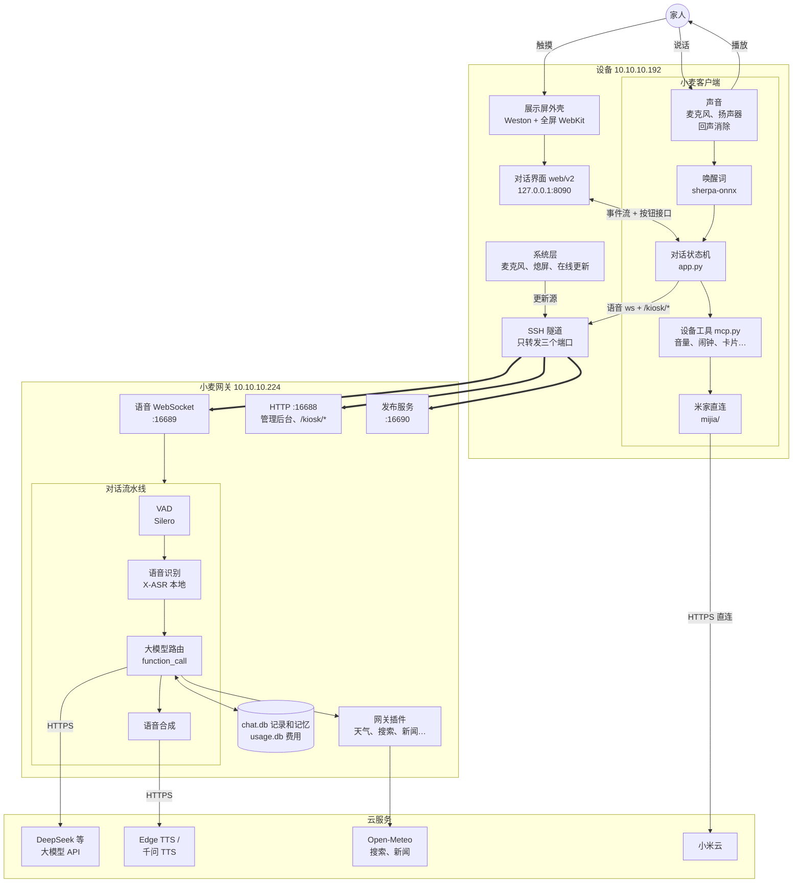
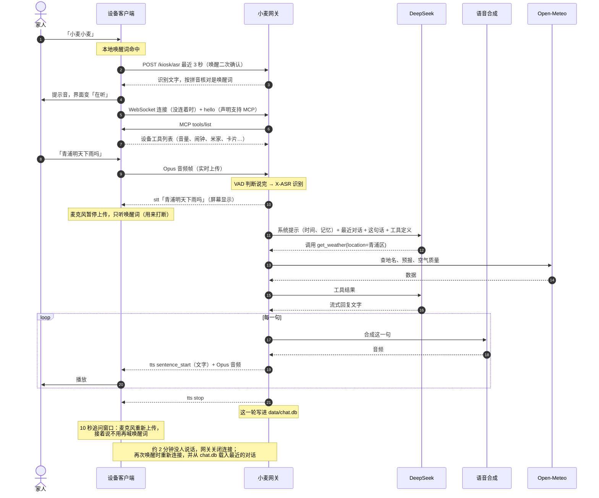
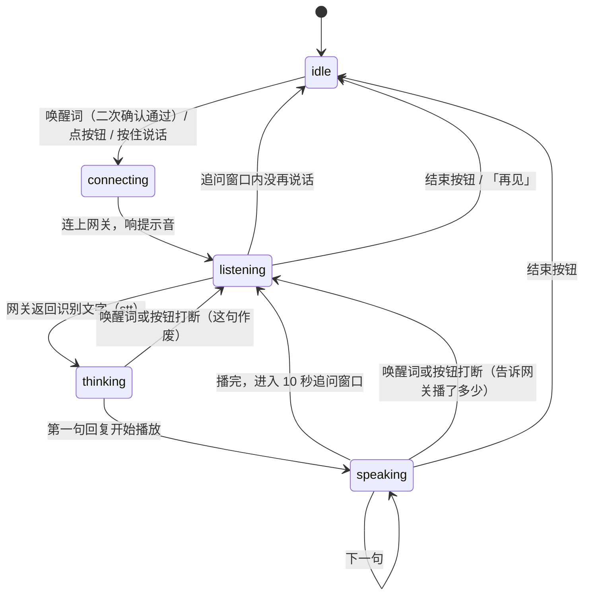
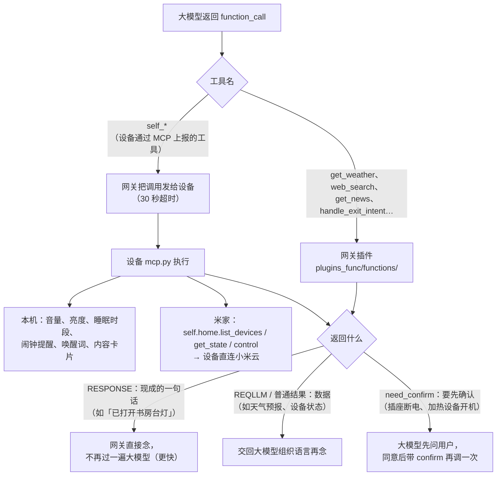
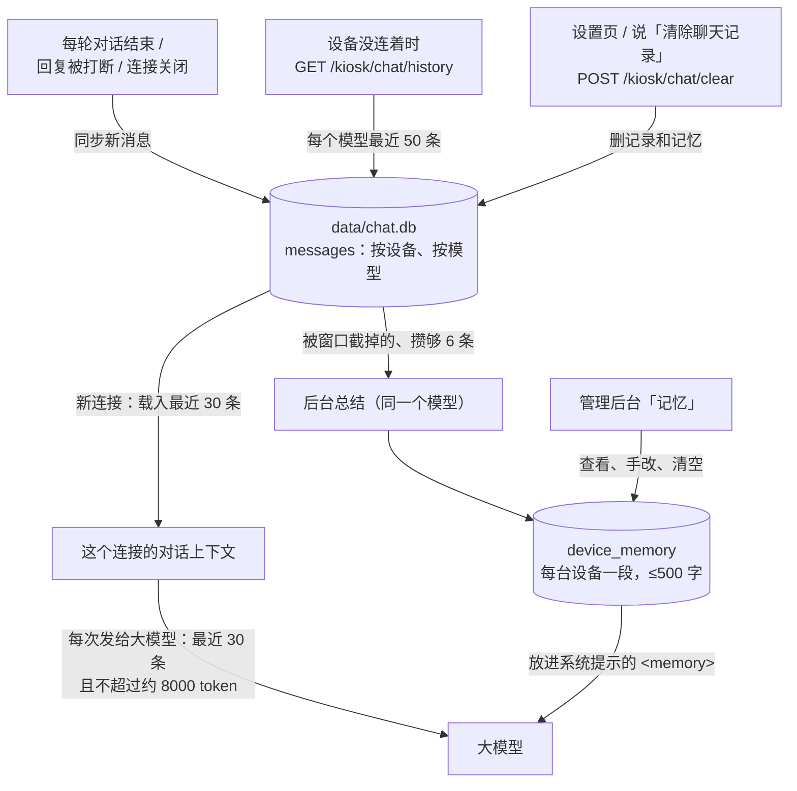
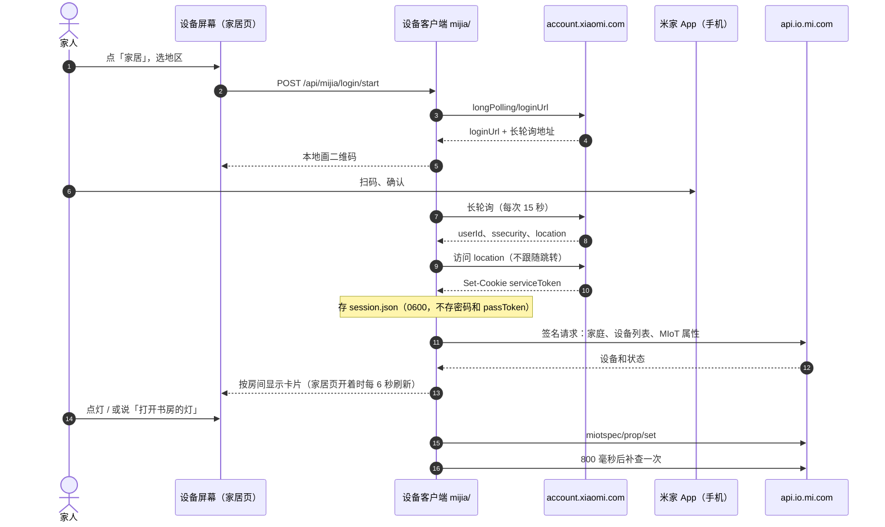
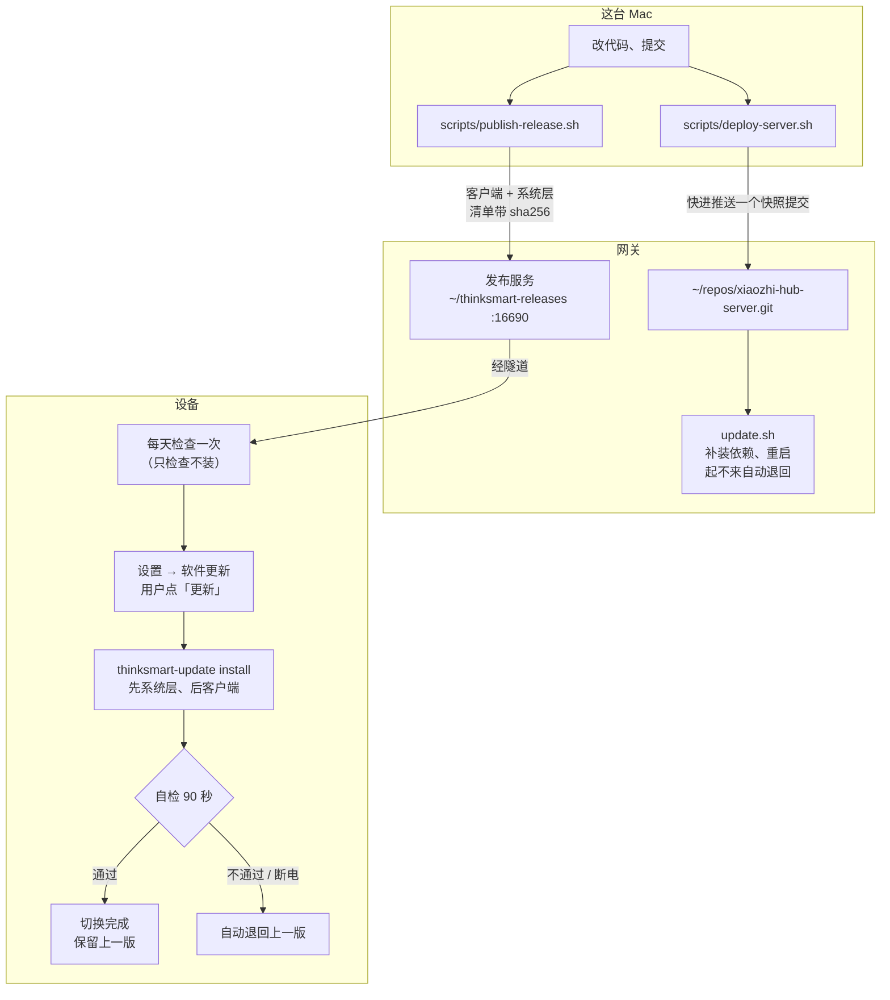
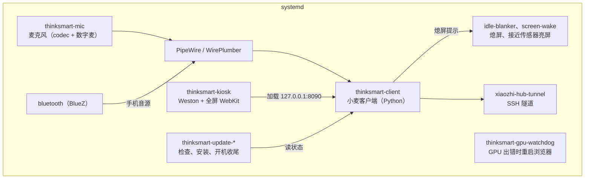
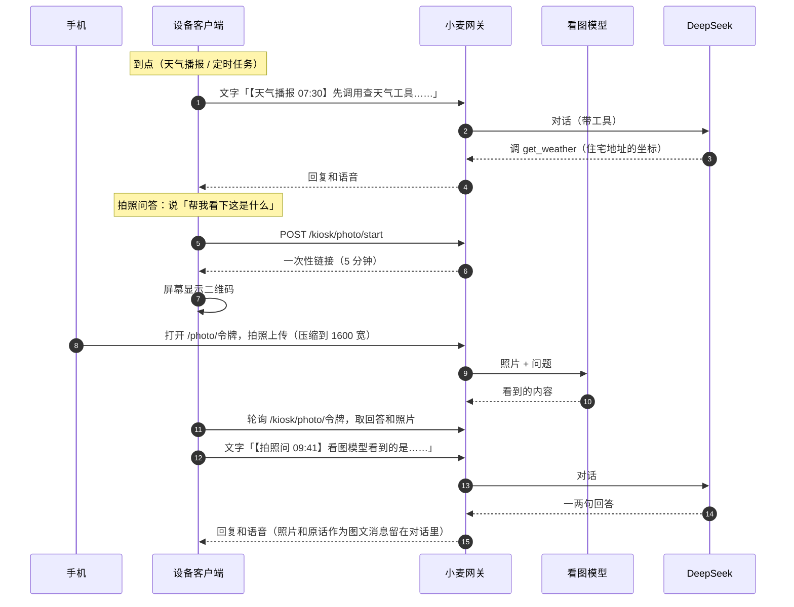

# 系统架构

小麦由三部分组成：**设备**（ThinkSmart View，跑客户端和系统层）、**网关**（局域网服务器上的小麦网关），以及网关和设备各自调用的**云服务**。设备只负责「听、放、显示、本机的事」，**听懂和回答都在网关**：语音识别、调大模型（比如 DeepSeek）、语音合成、聊天记录和记忆、查天气这类插件，都在网关上跑。设备自己不调大模型，也不保存任何大模型的 Key。

下面的图用 Mermaid 写，GitHub 上直接显示成图。

## 1. 总览

| 放在哪 | 做什么 | 不做什么 |
| --- | --- | --- |
| 设备 · 客户端 | 唤醒词、回声消除、录音上传、播放回复、对话界面、闹钟提醒（本机响）、米家（直连小米云）、蓝牙音箱、本机设备工具 | 不识别整句话，不调大模型，不存大模型 Key |
| 设备 · 系统层 | 全屏外壳、屏幕键盘、熄屏和接近传感器、麦克风服务、音频配置、在线更新和自动退回 | — |
| 网关 | 断句（VAD）、语音识别、大模型（按称呼切换模型）、插件、语音合成、聊天记录、记忆总结、费用统计、管理后台、唤醒二次确认、给设备发版本 | 不碰米家账号（米家令牌只在设备上） |
| 云 | 大模型、语音合成（Edge TTS 是微软的免费接口，千问 TTS 要百炼 Key）、天气、搜索 | — |

**为什么用 SSH 隧道**：网关的 `/kiosk/*` 接口不认证，只接受网关本机的请求。走隧道后，设备在网关看来就是 127.0.0.1，这些接口也不会暴露给局域网。隧道密钥只能转发这三个端口，拿不到 shell（见[部署](deploy.md)）。

### 端口

| 端口 | 在哪 | 用途 |
| --- | --- | --- |
| 8090 | 设备 127.0.0.1 | 对话界面、事件流、按钮接口（[客户端接口](../client/README.md#接口只监听本机)） |
| 16689 | 网关 | 语音 WebSocket `/xiaozhi/v1/`（小智协议） |
| 16688 | 网关 | 管理后台 `/admin`、设备接口 `/kiosk/*`、OTA、`/mcp/vision/explain` |
| 16690 | 网关 127.0.0.1 | 客户端和系统层的发布包 |

## 2. 一次对话

以「小麦小麦，青浦明天下雨吗」为例。DeepSeek 由**网关**调用，设备只收到识别出的文字、回复文字和合成好的声音。

**打断**：回复期间麦克风不上传，旁人说话、咳嗽都不会打断。只有喊唤醒词或点屏幕上的按钮才能打断，此时客户端告诉网关「这句话播了多少毫秒」，网关只把听到的部分留在上下文里。

**文字提问**：设置页或 `POST /api/text` 发来的文字，跳过语音识别，后面的流程一样。

## 3. 客户端状态

- `connecting`、`listening`、`thinking`、`speaking` 期间屏幕不熄。
- 「结束」会关闭网关连接、清掉网关这边的上下文（聊天记录还在）。
- 闹钟、倒计时、提醒到点时，不管在哪个状态都会停下当前对话开始响铃；喊唤醒词、点「停止」或「再睡」停下，没人管 10 分钟后自己停（提醒是 3 分钟）。

## 4. 工具调用：网关插件和设备工具

大模型能用两类工具。网关自己的插件在网关上执行，设备工具通过 MCP 交给设备执行。

内容卡片（`self.screen.show_card`）：菜谱、步骤、清单、表格这类适合看的内容，大模型把标题、Markdown 和图片链接交给设备，屏幕上的对话里多一条图文消息，嘴上只说一句。图片只能是大模型知道确实存在的 https 链接（DeepSeek 本身不能生成图片）。

## 5. 聊天记录和记忆

- 记忆是网关自己总结的（上游的 mem0 等记忆模块没用，配置里 `Memory: nomem`），记的是关于用户的事，比如「家里有三岁宝宝」「住在青浦」，这台设备所有普通 API 模型共用。
- Claude Code、Grok Bot 这类自己带会话的模型，上下文在它们自己那边，网关只存记录给屏幕显示。

## 6. 米家扫码登录和控制

米家账号只在设备上，网关不经手。

## 7. 发布和更新

版本号规则、跟进上游的方法见[更新](updates.md)。

## 8. 设备上的进程

## 9. 设备自己发起的请求

天气播报、定时任务、拍照问答都是设备自己发一句文字给网关（和设置页的文字提问同一条路），文字以【标签】开头，屏幕上显示成小标签，不显示成用户说的话。大模型照常调工具、回答，回答后 10 秒内可以接着问。

## 10. 数据存在哪

| 在哪 | 文件 | 内容 |
| --- | --- | --- |
| 设备 `~/.config/thinksmart-client/config.json` | 用户设置 | 唤醒词、天气播报、住宅地址、外观、儿童模式、待机页、场景、定时任务、告警、翻译模式（只存改过的） |
| 设备 `~/.local/share/thinksmart-client/` | `alarms/`、`cards.json`、`notes.json`、`photos/`、`avatars/`、`album/`、`offline/`、`kids-usage.json` | 闹钟、图文消息、留言、拍照问答的照片、照片形象、家庭相册、断网时的回答录音、儿童模式今天用了多久 |
| 网关 `data/` | `chat.db`、`usage.db` | 聊天记录和记忆、费用 |
| 网关 `data/` | `device_homes.json`、`device_prefs.json`、`device_lists.json`、`voiceprints.json` | 每台设备的住宅地址、儿童/翻译模式、清单、家人声纹（192 维向量，不存录音） |
| 网关 `data/photos/` | 拍照问答、形象、相册上传的照片 | 7 天后删，清除聊天记录时一起删 |
| 网关 `models/voiceprint/` | `3dspeaker_campplus_zh-cn_16k.onnx` | 声纹模型（不在仓库里，手动下载到这里） |
| 浏览器 localStorage | `xhub-ui`、`xhub-tables` | 网关后台的界面偏好、每个表格的列宽和顺序 |

### 设备接口（/kiosk/*，只接受经隧道来的本机请求）

`/kiosk/asr`、`/kiosk/tts`、`/kiosk/llm`、`/kiosk/chat/*`、`/kiosk/reports`、`/kiosk/billing`（原有），
`/kiosk/geocode`、`/kiosk/home`、`/kiosk/today`、`/kiosk/prefs`、`/kiosk/lists`、`/kiosk/photo/*`、`/kiosk/voiceprint/*`（这一轮加的）。
手机用的两个页面 `/photo/<令牌>`、`/lists/<令牌>` 在局域网里谁都能打开，令牌（128 位随机）就是凭证。

## 硬件限制

- **摄像头用不了**：设备自带的摄像头传感器是三星 s5kc505a，是联想定制件，主线内核没有它的驱动，设备树里摄像头（camss、cci）也是关闭的。`/dev/video0`、`/dev/video1` 是视频编解码器，不是摄像头。社区移植者也认为在主线内核上点亮它希望很小。所以「拍照问这是什么」现在做不了，现在用手机拍照代替（见下面的「拍照问答」）。
- **网关没有显卡**：8 核 i7-8700T 虚拟机、7 GB 内存，本地语音识别只能用小模型（现在是 X-ASR，每句约 0.1 秒）。
