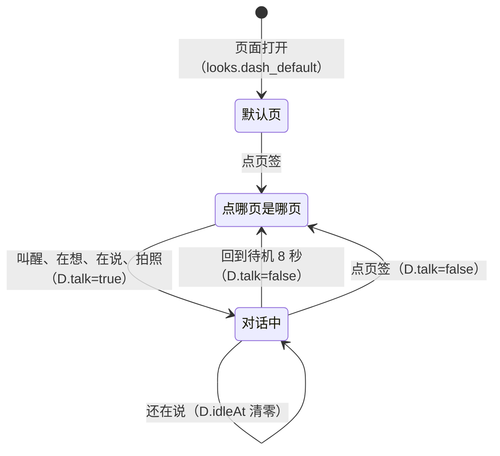
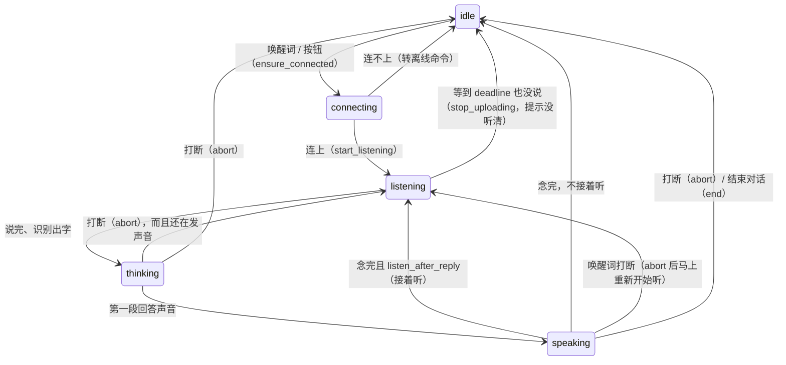

# 隐式状态机清单

这里列出代码里「没有写成状态机、但实际上就是状态机」的地方：几个布尔值或字段合起来决定现在处在哪个阶段，
由好几处代码各自改。每一节写明：状态存在哪、谁会改、要守住的规矩、已经出过的问题，以及排查时看什么。

改这些地方之前先读对应的一节；新加一个会改这些状态的入口时，照「规矩」那几条检查一遍。

整理于 2026-11-19（客户端 0.1.702）。

## 总览

| # | 状态机 | 状态存在哪 | 有没有一个地方能看到「现在是哪一个」 |
|---|---|---|---|
| 1 | 屏幕上是哪一页 | 页面：各 `.sheet` 的 `on`、`#standby[hidden]`、`body[data-dash]`、`body.fresh` | 有：`screen.js` 算出来，`GET /api/page-state`、日志 `page view:` |
| 2 | 仪表盘页签和对话时自动切页 | 页面 `dash.js` 的 `D.tab`、`D.talk`、`D.idleAt` | 包含在 1 里（`main/<页签>`） |
| 3 | 首页放不放得下 | 页面 `body.home-tight` | 没有（只是排版） |
| 4 | 一轮对话 | 客户端 `App.state` 加十来个标志 | 部分：`App.status()`（`state`、`uploading`、`recognising`） |
| 5 | 和网关的连接 | 客户端 `hub.connected`、`reconnect_after_reply` | `/api/health` 的 `hub` |
| 6 | 屏幕亮、暗、熄 | 客户端 `device.Screen`、系统层 idle-blanker、接近 / 光线守护进程 | 分散：`$XDG_RUNTIME_DIR/thinksmart-screen-state.json`、`thinksmart-proximity.json` |
| 7 | 谁在用喇叭和音量 | 客户端 `held_volume`、`sleep_saved_volume`、`preview`、`ring` | 没有 |
| 8 | 网关上的会话和缓存 | 网关：机柜 cookie、天气缓存、米家会话 | 分散，见各节 |

---

## 1. 屏幕上是哪一页

**状态**：页面上能盖住首页的有 11 个全屏层（`index.html` 里的 `.sheet`）：设置、工作台、家居、天气、选模型、
性能、Wi‑Fi、形象库等，再加待机页 `#standby` 和仪表盘的页签。每一层用自己的 `classList.toggle('on')`
或 `hidden` 开关，大约 30 处代码在改，没有统一的打开 / 关闭函数。

**怎么算现在是哪一页**（`web/v2/screen.js`，0.1.702 起）：
1. 待机页露着，就是 `standby`；
2. 否则取最后一个 `.sheet.on`（DOM 里靠后的盖在上面）。设置带分页（`settings/system`），工作台带页签（`work/rack`）；
3. 都没有，就是 `main/<仪表盘页签>`。不是仪表盘布局时，是 `main/welcome`（还没开始对话）或 `main/convo`。

结果一变就发 `screenchange` 事件，并报给客户端：设备日志记一行 `page view: …`；
`curl 127.0.0.1:8090/api/page-state` 能查到现在是哪一页，以及最近 20 次切换。

**规矩**
- 某一页被盖住时，它 `display: none`，量出来的大小都是 0：**不要在看不见的时候量排版**（见第 3 节）。
- 只在某一页露着时才做的事（轮询、动画），要在它**盖上和露出来时都重新判断**。不能只在「切分页」这一个入口判断；
  设置页的性能轮询就是靠监视 `#settings` 的 class 做到这一点的（`app.js` 里的 `perfMini`）。
- 新加的全屏层用 `.sheet` 和 `on`，`screen.js` 会自动认出来；id 就是它报出来的名字。

**出过的问题**：从工作台切回「对话」页时，时钟压在了页签上（0.1.701 修好，见第 3 节）。

## 2. 仪表盘页签和对话时自动切页（`dash.js`）



**规矩**：显示哪一页是 `D.talk ? 'chat' : D.tab`，统一在 `apply()` 里算。别的代码要切页签，调 `setTab()`，
不要直接改 `body.dataset.dash`。

**注意**：对话开始时，如果工作台、家居这类全屏层开着，`D.talk` 切换的是它们**下面**的页签。
开始听的时候，这些层由 `window.miAutoClose` 收起：`home.js` 先定义，`work.js` 再把它包一层，
所以收起的顺序取决于脚本加载的顺序。

## 3. 首页放不放得下（`home.js` 的 `fitHome`）

**状态**：`body.home-tight` 表示首页放不下，这时收起「试试这样问我」。

**规矩**
- 只在 `#welcome` 露着、有高度时才量；露出来、或者里面某一块变高变矮时，由 `ResizeObserver` 重新量（0.1.701 起）。
- `.welcome` 放得下时上下居中，放不下时从顶上开始排，多出来的部分在下面（用前后两个伸缩的空白撑开；
  不能用 `justify-content: center`，它会把内容往上挤出去）。

**出过的问题**：以前首页被工作台盖着时也在量，量出 0，就当成放得下、去掉了 `home-tight`。
切回来以后内容比屏幕高，又是居中排的，整块往上溢出，时钟压到了页签栏上（2026-11-19 的照片）。

## 4. 一轮对话（`app.py`）

`App.state` 有五个值：`idle`、`connecting`、`listening`、`thinking`、`speaking`，只由 `set_state()` 改。
细一点的阶段由这些标志一起决定：

| 标志 | 意思 | 置上 | 清掉 |
|---|---|---|---|
| `uploading` | 正在把麦克风的声音发给网关 | `start_listening` | `stop_uploading`、`abort`（还在识别时）、`end` |
| `vad_ended` | 网关说这句说完了，在识别（这时唤醒词也算打断） | 收到网关的说完消息 | 识别出字、`start_listening`、`abort`、断开 |
| `awaiting_text` | 客户端到点关了麦克风，网关还在识别 | `deadline` 到了 | 识别出字或没听到、`start_listening`、`abort` |
| `recognising` | 页面上显示「在识别」 | 说完以后 | 识别出字、`abort`、`set_state` 换状态时 |
| `listen_after_reply` | 回答念完后重新打开麦克风 | 识别出字、关上麦克风等回答时（播报、网关自己开口时也是） | 回答结束时 `wants_follow_up` 说不接着听、`_listen_after_reply` 用掉、`abort`、`end` |
| `deadline` | 接着听最多听到什么时候 | `wake`、`_listen_after_reply` | `stop_uploading`、`end` |
| `mute_audio` | 丢掉还在路上的旧回答声音 | `abort` | 下一段回答开始（`tts start`）、重连、断开 |
| `abort_pending`、`aborted_at` | 打断了，等网关确认 | `abort` | 网关确认（它的 `tts stop`）、断开；`aborted_at` 在下一次开始听时清 |
| `hub_pending` | 网关说「说完了」，还没给识别结果（字或「没听到」） | 收到网关的说完消息 | 识别出字或没听到、`start_listening`、`abort` |



**规矩**
- 打断一律走 `abort()`，结束对话一律走 `end()`。这两处统一清标志：新加的「这一轮」标志，两处都要清。
- `in_turn()` 决定唤醒词算不算打断：`thinking` 或 `speaking`，或者已经说完在识别，而且连着网关。
- `_listen_after_reply` 等回答真正念完才开始接着听（不然会把回答的尾巴发回网关）；等的时候如果被唤醒、
  打断或结束，就什么都不做。

**为什么没改成显式状态机**：这一块有 380 多个测试守着，线上也跑稳了。重写的风险大于好处。
暂时先把规矩写在这里；以后要新增阶段（比如「在念问候语」）时，再把这些标志收进一个「这一轮」对象，一次清掉。

## 5. 和网关的连接

叫醒时才连（`ensure_connected`），一段时间不说话网关就断开（日志 `hub connection closed`）。翻译模式在回答完以后，
要换参数重连（`reconnect_after_reply`）。断开时 `_on_closed` 收尾：正在听、正在想的这一轮会回到 `idle`。

## 6. 屏幕亮、暗、熄

有三方在动背光，各自守着一部分：

| 谁 | 管什么 | 状态在哪 |
|---|---|---|
| 客户端 `device.Screen` | 用户设的亮度、睡眠时段调暗、对话 / 闹钟 / 看照片 / 看视频时一直亮着（`held`、`ringing`、`showing`、`watching`） | 写提示文件给系统层 |
| 系统层 `idle-blanker` | 多久没碰就熄屏、熄屏后的亮度、关灯熄屏（`LightGate`） | `$XDG_RUNTIME_DIR/thinksmart-screen-state.json`（`blanked`、`blank`） |
| 接近、触摸、光线守护进程 | 走近亮屏（`Gate`，按开机时的读数校准）、碰一下亮屏、测光 | `thinksmart-proximity.json`（`baseline`、`threshold`、`lux`） |

**规矩**：客户端只写「想要什么」（提示文件），由系统层决定背光，客户端再读回来；客户端不直接写背光。
熄屏时页面不停：`body.screen-dark` 只暂停动画（2026-11-15 用户明确说过不要黑屏）。

## 7. 谁在用喇叭和音量

| 谁占着 | 记下原来的音量 | 断电、崩溃后怎么还原 |
|---|---|---|
| 闹钟响、试听铃声（`_hold_speaker`） | `held_volume`，同时写 `ring-state.json` | 启动时 `_restore_volume` 读这个文件，还原 |
| 睡眠时段（`_sleep_volume`） | `sleep_saved_volume` 写进 config.json | `_apply_sleep`：在时段里重启就补上，过了时段才重启就还原 |

**规矩**：改音量的入口统一走 `set_volume()`（带 `source`）。占用喇叭要成对：`_hold_speaker` 对 `_release_speaker`。

**注意**：设备没有电池时钟。断电重启后，时间先回到上次存下的时刻，大约一分钟后才对上网络时间，
所以「在不在睡眠时段」会先算错一次，再改回来；闹钟要等日志里出现 `system clock synchronised` 才开。

## 8. 网关上的几个会话和缓存

- **机柜（rack-screen）**：网关用登录密码换 cookie。代理请求遇到 401 或被跳到 `/login`，就重新登录一次再请求
  （`core/integrations/webproxy.py`、`rack.session`）。
- **天气**：上一次取到的结果存在 `data/.today-weather.json`，12 小时内连不上天气服务就照旧给，标上「N 分钟前的」。
  设备拿到空结果时不覆盖原来的，2 分钟后再取。
- **米家**：会话过期时，小米返回 `code 0` 加空结果，客户端把这种情况当作过期，提示重新扫码。

## 排查时先看什么

```bash
curl -s 127.0.0.1:8090/api/page-state      # 屏幕上是哪一页、最近 20 次
curl -s 127.0.0.1:8090/api/health          # 版本、音频、网关连没连
journalctl -u thinksmart-client -n 100 | grep -E "state:|page view:|abort|after the reply"
cat $XDG_RUNTIME_DIR/thinksmart-screen-state.json $XDG_RUNTIME_DIR/thinksmart-proximity.json
```
